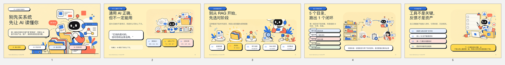
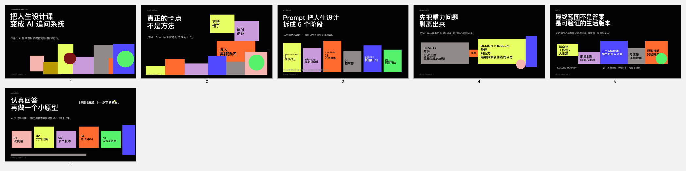
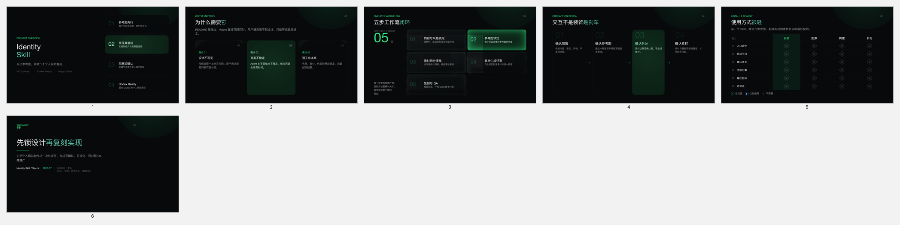

# Guozhi PPT Director

## 这是什么

`guozhi-ppt-director` 是一个面向 Codex 与 Agent 的中文 PPT 导演 Skill。仓库根目录的 `SKILL.md` 是触发入口；它把文章、PDF、链接、脚本或业务资料转成经过确认的演示方案，并协调 PPTX、网页演示、PDF、DashiAI 渲染和质量检查。

## 它解决什么问题

普通“文章转 PPT”流程容易直接猜页数、猜风格、混用渲染器，或者只参考封面导致整套页面僵硬。这个 Skill 用稳定协议约束完整流程：先归一化输入，再给出一个完整推荐，确认页数、交付格式、路线和风格后才允许渲染。

## 适合谁

- 需要把文章、PDF、链接或研究材料制作成演示文稿的用户。
- 需要可编辑 PPTX、演讲备注、网页演示或 PDF 的内容创作者与团队。
- 需要把 PPT 生产作为独立能力调用的父 Agent。
- 需要维护可检索、多页面角色风格库的 Skill 作者。

## 适用场景

在用户要求创建、修改、审查或美化 PPT，管理风格库，或者让 Agent 协调演示文稿生产时使用。只做一次性摘要、没有演示文稿交付需求时不应触发。

## 输入

- 文章、PDF、网页链接、文本、现有演示文稿或既有运行包。
- 页数、演讲时长、语言、交付格式、演讲备注和改写边界等约束。
- 风格库 ID、`preserve_existing`，或 DashiAI 主题。
- 人类交互模式 `human` 或 Agent 交互模式 `agent`。

机器调用遵循 [`contracts/invocation.schema.json`](contracts/invocation.schema.json)，稳定操作包括 `deck.create`、`deck.revise`、`deck.review`、`style.list`、`style.add`、`style.update`、`style.remove` 和 `help`。

## 输出

- 机器可读的 `run-manifest.json` 和结果信封。
- 简报、提纲、风格匹配、风格板、制作路线和 QA 报告。
- 按确认路线生成并验证的 PPTX、HTML、PDF 或审查结果。
- Agent 模式下符合 [`contracts/result.schema.json`](contracts/result.schema.json) 的结构化结果。

## 安装

通过 Codex Skill 安装器安装：

```text
请安装 GitHub 仓库 GZ-L/guozhi-ppt-director 中的 Skill
```

也可以克隆到个人 Skill 目录：

```bash
git clone git@github.com:GZ-L/guozhi-ppt-director.git \
  "$HOME/.codex/skills/guozhi-ppt-director"
```

仓库不分发第三方视觉截图。需要风格参考图时，只能从你有权使用的来源在本地采集；详见 [`NOTICE.md`](NOTICE.md) 和 [`references/style-library/README.md`](references/style-library/README.md)。

## 使用方法

人类调用示例：

```text
使用 guozhi-ppt-director，把这篇文章做成 6 页中文 PPT，
交付可编辑 PPTX，带演讲备注。先给出推荐配置并等我确认。
```

Agent 调用示例：

```json
{
  "protocol_version": "1.0",
  "request_id": "req-demo-001",
  "operation": "deck.create",
  "interaction_mode": "agent",
  "source": [
    {"type": "url", "location": "https://example.com/article", "role": "primary"}
  ],
  "constraints": {
    "language": "zh-CN",
    "page_count": 6,
    "deliverable": "pptx",
    "route_id": "native_pptx",
    "style_id": "ref-16-black-ai-collaboration-editorial",
    "rewrite_boundary": "rebuild",
    "speaker_notes": true
  },
  "confirmation": {"status": "confirmed", "exact_text": "按已确认配置执行"}
}
```

完整调用顺序以 [`CALLING_SPEC.md`](CALLING_SPEC.md) 为唯一运行规范；修改 Skill 前先读 [`MAINTENANCE_SPEC.md`](MAINTENANCE_SPEC.md)。本次对话中真实出现的交互、回归缺陷和 Agent 示例见 [`examples/REAL_CASES.md`](examples/REAL_CASES.md)。

## 真实案例

以下案例来自实际运行，仓库同时提供可编辑 PPTX 与全页预览。完整索引和验证记录见 [`examples/decks/README.md`](examples/decks/README.md)。

### AI 知识库：动漫扁平插画风

[下载 5 页可编辑 PPTX](examples/decks/ai-knowledge-flat-illustration/deck.pptx)



### Life Design Prompt：ref-16 黑色 AI 编辑风

[下载 6 页可编辑 PPTX](examples/decks/life-design-ref16/deck.pptx)



### Identity Skill：DashiAI 路线

[下载 6 页带演讲备注 PPTX](examples/decks/identity-skill-dashiai/deck.pptx)



## 实际效果

Skill 将不完整请求归一化为一套可确认配置，禁止在 `confirmed` 和 `planned` 之前渲染，并把故事结构、风格锁定、页面角色、渲染路线和 QA 证据记录在同一个运行包中。单图参考默认只能用于封面；完整演示优先使用覆盖封面、正文、流程、数据和结尾等角色的多图风格包。

## 边界与非目标

- 不在信息缺失时主观猜测页数、路线或风格。
- 不用 A/B/C 等字母代替稳定路线或风格 ID。
- 不复制参考图中的文字、品牌、人物、产品、插画、声明或精确构图。
- 不把 DashiAI 代码或资产内嵌进本仓库；它只作为可选外部渲染器。
- 不承诺所有来源都能自动抓取；登录墙、失效链接和权限不足会返回 `blocked` 或 `needs_input`。
- 不把未验证的文件标记为 `completed`。

## 来源说明

协议、模板、验证脚本和 Agent 协调逻辑由 GZ-L 维护。风格目录只保存来源 URL、角色覆盖和视觉特征等元数据；实际第三方截图保持本地，不随 Git 仓库发布。DashiAI 是独立外部项目，遵循其自身许可证和安装方式。

## 验证

基础协议和发布包验证：

```bash
python3 scripts/validate_contract.py
python3 -m unittest discover -s tests -p 'test_*.py' -v
python3 "$HOME/.codex/skills/standard-skill-maker/scripts/validate_skill.py" .
python3 "$HOME/.codex/skills/.system/skill-creator/scripts/quick_validate.py" .
```

本地已经配置完整风格截图时，再执行严格资产验证：

```bash
python3 scripts/validate_contract.py --require-style-assets
```

发布前还应运行 `GZ-L/skill-upload-standard` 的验证脚本，并在临时克隆中重复执行基础检查。

## 许可证与版权边界

本仓库当前未声明统一开源许可证，因此不要推定获得复制、修改或再分发权限。第三方网页、截图、模板、字体、品牌和 DashiAI 分别受其权利人条款约束。具体边界见 [`NOTICE.md`](NOTICE.md)。
